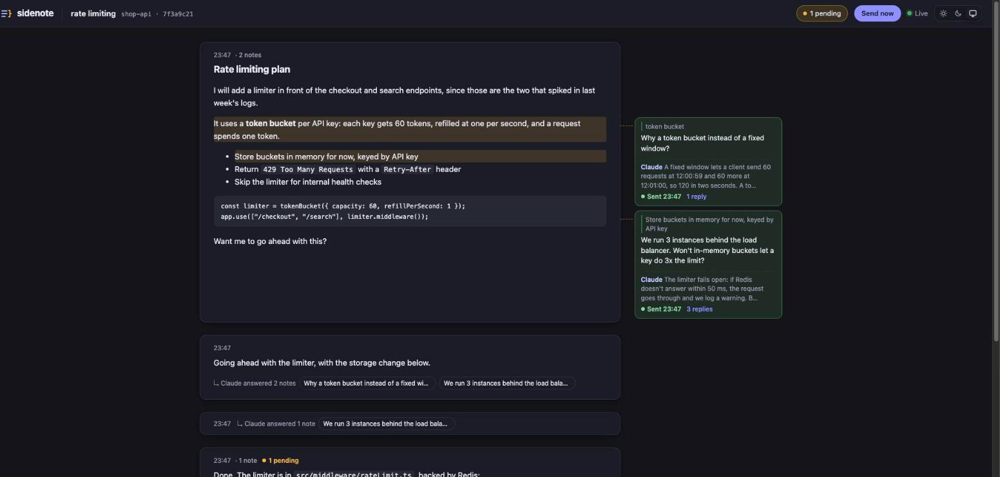
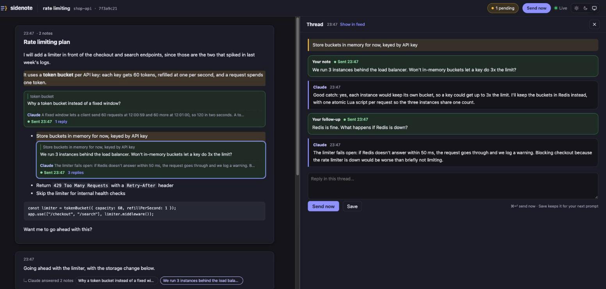
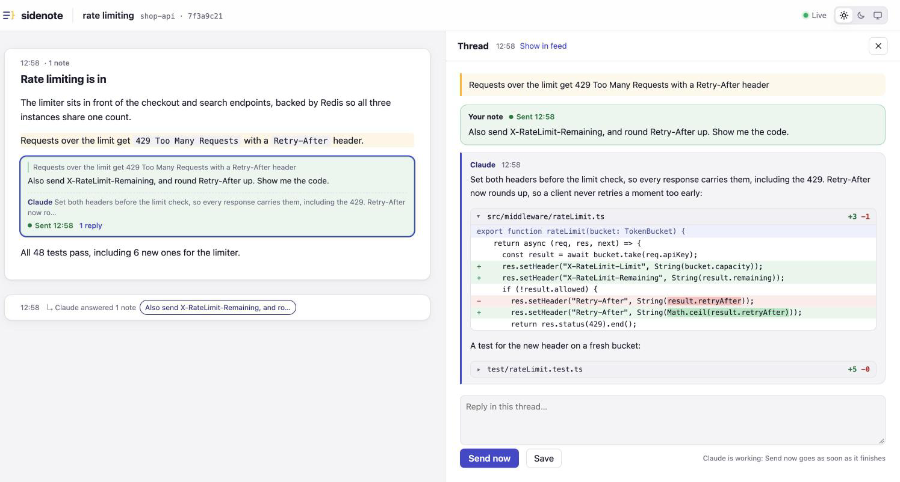

# sidenote

Leave inline notes on Claude Code's replies in a browser window, and send them back to Claude,
right away or with your next prompt.



Reading a long reply in the terminal and then typing "about the second point…" is clumsy.
With sidenote, every reply Claude finishes appears in a browser window. You select the text
you have a question about, write a note beside it, and click **Send now**. Claude answers each
note on its own, and each answer lands in that note's thread.



## Features

- **Notes in the margin.** Select any text, or hover a paragraph and click **+**. Notes sit next
  to the text they are about, or inline when the window is narrow.
- **Send now.** Claude answers your notes straight away, with nothing typed in the terminal.
  **Save** keeps a note until your next prompt instead.
- **Message Claude from the browser.** Type in the box at the bottom of the window and press
  **Enter**: Claude gets it as if you had typed it in the terminal, with your pending notes
  alongside. While Claude is working, the message waits and goes as soon as it finishes. Your
  messages show in the feed between Claude's replies, including prompts typed in the terminal.
- **See what Claude is doing.** While you wait for a reply, a live card shows what Claude last
  wrote, with the current step beside the typing dots, like `Editing src/app.ts` or
  `Running npm test`, never the code itself. Earlier messages from the turn fold open from the
  card, and it all goes when the reply lands.
- **Threads.** Click a note to open its thread beside the feed: your note, Claude's answer,
  your follow-ups. Claude's answer appears only in the thread, never duplicated in the feed.
- **Code changes as diffs.** When you ask Claude to see or change code, in a note or in the
  terminal, it explains each change and shows it as a diff, with the edited words highlighted.
  Answers that touch several files fold each file open from its header.
- **One window per folder, with its sessions in a list.** Each folder gets its own window, at an
  address you can bookmark: `http://sidenote.localhost:<port>/<folder>`. The list on the left
  holds every Claude Code session that ran in that folder, named with the name you gave it with
  `/rename`, or its first message, with whether it is listening and how many notes are pending.
  In a narrow window, or while a thread is open, the list folds away; the button left of the
  folder name brings it back. Notes always go back to the session they were written on.
- **Open folder.** Click the folder name to open the folder on your computer, with whatever app
  your system opens folders with.
- **Start a session from the window.** The **+** above the session list opens a terminal in the
  folder, running Claude with the first prompt you type there, and selects the new session. Claude
  asks for permissions in that terminal; after its first reply you can carry on from the window.
  This needs GNOME Terminal on Linux, or Terminal on macOS, where the first start asks you to let
  the app sidenote runs under control Terminal. A name you give it there also titles the terminal.
- **Name, end and remove sessions.** The **⋯** on a session's row renames it, for example after a
  ticket, with a name only sidenote shows. It also ends a running session, which stops its Claude
  process even mid-turn and takes it off the list, and removes a session that has ended. A session
  shows as ended once sidenote knows its process, which it learns from the session's next prompt
  or reply.
- **Light, dark, or system theme**, from the switch in the top right.
- **Local only.** Everything stays on your machine. See [Security](#security).



## Requirements

- Claude Code with plugin support and `asyncRewake` hooks (any recent version)
- Node.js 20 or newer
- macOS or Linux

## Install

The repository is its own plugin marketplace.

```shell
claude plugin marketplace add sous17/sidenote
claude plugin install sidenote@sidenote
```

Or inside Claude Code: `/plugin marketplace add sous17/sidenote`, then
`/plugin install sidenote@sidenote`.

While the repository is private, the machine needs GitHub access to it first. The simplest
way is the GitHub CLI: `gh auth login`, then `gh auth setup-git`.

Then restart Claude Code, or run `/reload-plugins`, and turn sidenote on:

```
/sidenote:on
```

Your browser opens the sidenote window of this session's folder. From now on, every reply Claude
finishes shows up there. Other sessions in the same folder join its session list; a session in
another folder opens that folder's window with its first reply.

### From a local copy

```shell
git clone https://github.com/sous17/sidenote.git
claude plugin marketplace add ./sidenote
claude plugin install sidenote@sidenote
```

## Using it

1. **Leave a note.** Select text in a reply and click **Add sidenote**, or hover a paragraph and
   click **+**. To comment on a reply as a whole, click **Note on whole reply** next to its time.
2. **Send it.**
   - **Send now** (or ⌘↵ / Ctrl+↵) wakes Claude to answer right away. If Claude is busy, the
     note goes as soon as it finishes.
   - **Save** keeps the note pending. It goes to Claude with the next prompt you type in that
     session.
   - The **Send now** button in the top bar sends every pending note at once.
3. **Read the answer.** The reply shows up in the feed as a short "↳ Claude answered 1 note" row,
   and the full answer is in the note's thread. Notes in the margin show a preview of it.
4. **Keep going.** Click a note to open its thread, and reply there. Follow-ups are sent with
   the earlier notes, so Claude has the context.

| Command              | What it does                                                                     |
| -------------------- | -------------------------------------------------------------------------------- |
| `/sidenote:on`       | Turns sidenote on and opens its folder's window on this session                  |
| `/sidenote:off`      | Turns it off for all sessions. Pending notes are kept for next time              |
| `/sidenote:restart`  | Restarts the server and opens the window on this session. Pending notes are kept |
| `/sidenote:open`     | Reopens the window on this session, for example after closing it                 |
| `/sidenote:status`   | Shows this session's window address, replies, pending notes, and Send now status |
| `/sidenote:backfill` | Imports this session's earlier replies, so you can leave notes on those too      |

## Update and uninstall

```shell
claude plugin marketplace update sidenote
claude plugin update sidenote@sidenote
```

```shell
claude plugin uninstall sidenote@sidenote
```

Your notes are kept in `~/.sidenote/` outside the plugin, so they survive updates and
reinstalls. Delete that folder to remove them.

Each session has its own file in `~/.sidenote/sessions/`. sidenote keeps up to 100 replies per
session, and forgets a session, with its replies and notes, after 7 days without a new reply.

`/clear` forgets the session it ends right away, so its window moves on to the folder's next
session. A session with notes or messages that never reached Claude is kept, and goes after the
usual 7 days. If you resume a cleared session later, its window starts empty; Claude's own
transcript isn't touched.

## Troubleshooting

**Send now is greyed out.** The session isn't listening yet. That happens when sidenote was
turned on, or the plugin installed, after that session's last reply. Send any prompt in that
session; once Claude replies, the button turns on. Saved notes still go with your next prompt.

**Nothing appears in the window.** Run `/sidenote:status` in that session. If it says
`enabled: no`, run `/sidenote:on`. If the tab says "Stale tab" or "Not connected yet", run
`/sidenote:open` once: a restart of sidenote retires the browser's token, and the window that
opens hands it a new one, which every open sidenote tab picks up.

**The list shows a session's first message, not its name.** Rename it from its **⋯**, or name
it with `/rename` in Claude, which the list picks up with Claude's next reply.

**End session is greyed out.** sidenote knows a session's process only once one of its hooks ran
since sidenote started. Send a prompt in that session, or wait for its next reply.

**Two folders share a window.** A window is named after the last part of the folder's path, so
`~/work/shop` and `~/play/shop` share one. Hover over the folder name to see the selected
session's full path.

**Hooks can't find Node.** Hooks don't always get your shell's `PATH`, for example with nvm
when Claude Code isn't started from a terminal. sidenote also looks in the usual Homebrew,
Volta, mise, asdf, nvm and fnm locations. If it still can't find Node, set `SIDENOTE_NODE` to
the full path of your `node` binary. Problems are logged to `~/.sidenote/server.log`.

## How it works

Seven hooks connect Claude Code to a small local server:

- **Stop** (`hook-stop`) posts each finished reply to the server, starting it if needed, and
  opens the session's window the first time that session replies.
- **Stop, in the background** (`hook-wait`, with `asyncRewake`) waits for **Send now** or a
  message from the window's message box. Then the hook prints your message and notes and exits
  with code 2, which wakes Claude to answer.
- **PreToolUse, in the background** (`hook-activity`, with `async`) reports each tool call in
  one line for the window. The server keeps only the latest, in memory, until the turn ends.
- **MessageDisplay, in the background** (`hook-progress`, with `async`) reports what Claude writes
  between tool calls, for the live card. The server keeps it in memory until the turn ends.
- **UserPromptSubmit** (`hook-prompt`) shows the prompt you type in the window and attaches
  pending notes to it, along with any message from the window that was still waiting.
- **SessionEnd** (`hook-clear`, for `/clear` only) tells the server to forget the session.
- **SessionStart** (`hook-session`) asks Claude to show code changes as diffs, so the window can
  draw them, and to ask questions in its reply rather than with the `AskUserQuestion` tool, so
  they reach the window and can be answered from it. It applies to sessions started, resumed or
  cleared while sidenote is on. Permission prompts and plan approval still wait in the terminal.

When notes reach Claude, it is asked to answer each one under a line like `**↳ Re: note 12**`.
The server moves those sections out of the reply and into the notes' threads. If Claude leaves
the markers out, the reply stays whole in the feed and the thread links to it.

## Security

Anyone who can call sidenote's API can put words in front of your Claude session, so the API is
locked down:

- **Local only.** The server listens on `127.0.0.1`, and refuses requests whose `Host` header
  isn't one of its own addresses (`127.0.0.1`, `localhost` or `sidenote.localhost`, each with
  its port), which blocks DNS-rebinding attacks.
- **A token for every call.** A random 256-bit token, created on each start, is stored in
  `~/.sidenote/server.json`, readable only by you. It travels in a custom header, which other
  websites can't send to the server: the server never approves a cross-origin request.
- **No token in URLs.** The CLI opens a window with a single-use launch code in the URL
  fragment, which browsers never send over the network. The page trades the code for the token
  once, so browser history, synced history and `ps` only ever see a spent code that expires
  within two minutes anyway. The page keeps the token in local storage, which only pages from
  sidenote's own address can read, so a window's address works when typed or bookmarked. The
  token stops working when the server restarts, since each start makes a new one.
- **Validated input.** Every request body is parsed against a fixed shape, with size limits,
  before it reaches the store. Session ids must look like ids.
- **Recorded folders only.** Open folder and the **+** name a session, not a path: the server
  opens the folder it recorded for that session, or starts Claude there, and nothing else.
- **No shell for your prompt.** A new session's first prompt reaches `claude` as one argument
  after `--`, so it can't add options, and on Linux it never passes through a shell. On macOS,
  Terminal runs the command through your shell, so AppleScript's `quoted form of` quotes the
  folder and the prompt first.
- **Only Claude's own processes.** Ending a session stops the process the session's own hooks
  reported as its Claude, and only while that pid still belongs to the process that started at the
  reported time. A request never names a pid. Beyond talking to running sessions, the token can
  open the folders sidenote knows, start sessions in them, and end the sessions it knows.
- **Inert replies.** Raw HTML in a reply is shown as text. The rendered markdown is sanitized
  with DOMPurify, which also strips forms, ids and classes that could imitate sidenote's own
  controls. The page's content security policy allows no inline or remote scripts, and every
  response carries `nosniff`, `no-referrer` and anti-framing headers.
- **Private files.** `~/.sidenote` and everything in it are readable only by you.

Found a security problem? Please report it privately through GitHub's
[security advisories](https://github.com/sous17/sidenote/security/advisories/new) rather than
in a public issue.

## Development

Development needs Node 22.18 or newer: tests run the TypeScript directly with Node's type
stripping, with no compile step. The plugin itself runs on Node 20 or newer.

```shell
npm install
npm run check      # formatting, types, build dist/, then the tests
npm run format     # apply Prettier
```

| Path                                   | What's there                                                             |
| -------------------------------------- | ------------------------------------------------------------------------ |
| `src/shared/types.ts`                  | The API contract, used by the server, the hooks and the page             |
| `src/server/`                          | Request parsing, the store, Send now, launch codes, and the HTTP routes  |
| `src/cli/`                             | The `/sidenote:*` commands and the hooks                                 |
| `src/node/`                            | Paths and clock, shared by the server and the CLI                        |
| `src/web/`                             | The page: feed, thread pane, note editor, and Send now controls          |
| `test/`                                | Unit tests, HTTP security tests, and an end-to-end run of the real hooks |
| `bin/sidenote`                         | Finds Node and runs `dist/cli.js`                                        |
| `hooks/`, `skills/`, `.claude-plugin/` | The plugin wiring                                                        |
| `dist/`                                | Built output, committed so installing needs no build step                |

Run `npm run build` after changing anything in `src/`, and commit `dist/` with it. CI runs
`npm run check` on Linux and macOS and fails if `dist/` doesn't match the source.

To try a change without reinstalling, start Claude Code with `claude --plugin-dir .` from this
folder.

## License

MIT
