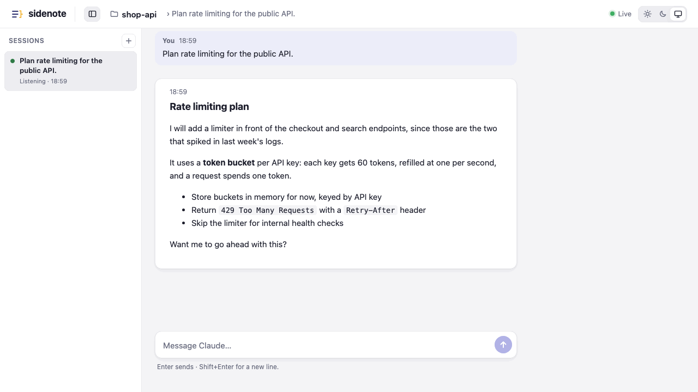
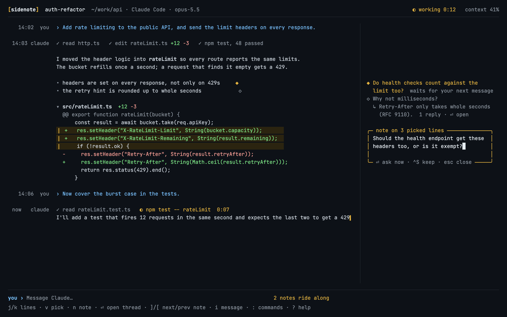

# sidenote

Leave inline notes on Claude Code's replies in a browser window, and send them back to Claude,
right away or with your next prompt.

**[Read the documentation](docs/index.html)** to install it and learn how it works.

## Terminal app (work in progress)

sidenote in a terminal, with notes beside their lines. This is a design mock, not a finished app.

## License

MIT
